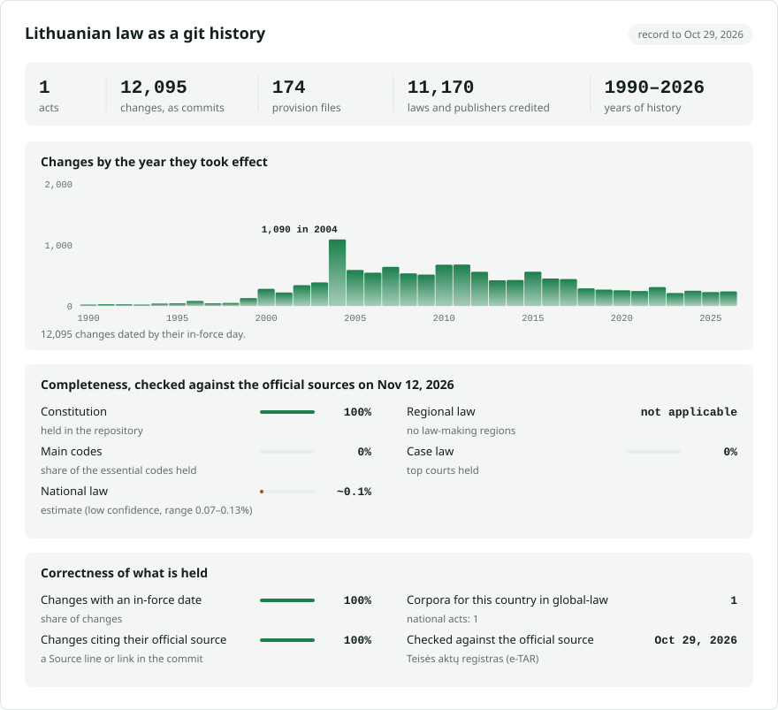

# Lithuania: law history in git

**English** · **[Arba skaitykite lietuviškai](README.md)**

<picture>
<source media="(prefers-color-scheme: dark)" srcset="data/effort-dark.svg">

</picture>

The law of Lithuania as a git history: one file per provision, one commit per change on the day it took effect, and the act that made each change as the commit's author. `git blame` names the act behind every paragraph; `git log` lists every change to an article; picking a date gives the text in force that day.

Part of [lexifina/global-law](https://github.com/lexifina/global-law), one git history for every country's law: this is Lithuania's national law, which global-law reads at `lithuania/national/acts/`.

**What is in it now:** the Constitution adopted by referendum on 25 October 1992 and every change since: 12 versions, from the text in force on 2 November 1992 to the one in force from 22 May 2022, made by 13 amending laws, with 2 Constitutional Court documents that change no words (16 commits). No other act is here yet. [`konstitucija/README.md`](konstitucija/README.md) lists every provision and how often it changed.

Each provision is one file in `konstitucija/`: the preamble (`preambule.md`), the 15 chapter headings (`skirsnis-01.md` to `skirsnis-15.md`), the 154 articles (`art-001.md` to `art-154.md`; `art-119.md` is Article 119, local government) and, from 2004, the Constitutional Act on membership of the European Union (`sudedamoji-4-es.md`).

The text is in Lithuanian, as the Register of Legal Acts (Teisės aktų registras, e-TAR) prints it. An English translation is not part of this record.

## Questions as git commands

| Question | Command |
| --- | --- |
| Every change to Article 119 of the Constitution | `git log -p --word-diff -- konstitucija/art-119.md` |
| Which act wrote each line of Article 119? | `git blame konstitucija/art-119.md` |
| Every change to the Constitution, with the day each took effect | `git log --grep="^In-force:" --format="%h %(trailers:key=In-force,valueonly,separator=) %an"` |
| Article 119 as in force on 1 January 2000 | `python tools/on.py 2000-01-01 konstitucija art-119` |

**Outside git**, we also host this record publicly, for free:

- **[Ask Claude about Lithuanian law](https://global-law.lexifina.com/v1/try_claude?country=lithuania)**: opens Claude with a first question ready.
- **[Ask ChatGPT](https://global-law.lexifina.com/v1/try_chatgpt?country=lithuania)**: the same question in ChatGPT.
- **[Call the API in your browser](https://global-law.lexifina.com/v1/search_law?query=atostogas&jurisdictions=lithuania)**: a search of Lithuanian law for "atostogas", returned as JSON. See the [documentation here](https://lexifina.com/api/global-law).

Both assistants read the record through the free Global law connector (MCP, `https://global-law.lexifina.com/mcp`); the first time, the chat gives you the link that adds it. Ask in Lithuanian or in English.

**Host it yourself easily.** All it takes is git and Python, and the tools run on your machine:

```sh
git clone --depth 1 https://github.com/lexifina/global-law && cd global-law
python3 tools/countries.py add lithuania/national/acts
python3 tools/law.py show 2026-01-01 lithuania/national/acts/konstitucija/art-119.md
```

Opened in Claude Code, Cursor, VS Code or Codex, the clone also starts a local MCP server with the same tools ([MCP.md](https://github.com/lexifina/global-law/blob/main/MCP.md)).

## Dates

Each commit is dated at noon, Europe/Vilnius, on the day the change took effect, and carries it in its `In-force:` trailer:

- for every version, the day the Register gives its consolidated edition ("Suvestinė redakcija nuo …"). A law amending the Constitution takes effect no earlier than one month after its adoption (Art. 149(3)); none of these laws names a day of its own;
- for the Constitution as adopted, 2 November 1992;
- 16 November 2013 and 24 January 2014 are the Constitutional Court's notice suspending Law X-572 (Article 125, 2006) and its ruling KT2-N1/2014 that the law was adopted contrary to Art. 147(1). The Register keeps printing the 2006 words with a note, and so does this record: both commits say "wording unchanged".

Each change is credited to the act the Register lists for that edition (`Įstatymas Nr. XIV-1028`); where several laws took effect on one day (21 April 2003, 14 August 2004, 22 May 2022), each article is credited to the law the Register's note under it names ("Straipsnio pakeitimas: Nr. …"). The first commit is credited to the referendum of 25 October 1992.

## How it is checked

- The Constitution as adopted and the editions in force from 2014 are the Register's own texts, each read from a pinned Internet Archive capture. No archive holds the Register's editions of 1996-2013, so those versions apply each amending law's own words to the version before; the build stops if the law's operative words differ.
- The texts in force from 2004 on equal the Seimas's own copy of the Constitution (lrs.lt) in all 170 units, as archived from 2006 to 2026 and as served on 29 October 2026; the replayed text of 2006 also equals the Register's 2014 edition.
- Every version is read back from git on the day it took effect and on the day before (`tools/check_repo.py`), and must match the corpus. Results are in [`REPRODUCE.md`](REPRODUCE.md).
- History is append-only: no merge commits, no commit dates that go backwards, no commit dated in the future, and every commit's trailers parse.

## What it does not show

- **Ordinary laws and codes.** Only the Constitution is built; the codes, the other laws and the rest of the Register are not here yet.
- **Case law, local acts, treaties, EU law and bills.** None is here, apart from the Constitutional Court's 2013 notice and 2014 ruling on Article 125.
- **The Register's own editions of 1996-2013.** Those versions are the amending laws applied by code and checked as above. One point follows the consolidated texts rather than the law: Law IX-1378 ends the restated Art. 84 point 11 with a full stop, where every consolidated text keeps the list's semicolon.
- **Three component parts of the Constitution** that Art. 150 lists, of 1991-1992 (the Constitutional Law "Dėl Lietuvos valstybės", the Constitutional Act on non-alignment with post-Soviet eastern unions, and the Law on the procedure for the entry into force of the Constitution): they are separate acts. The fourth, on membership of the European Union, is here.

## Sources

| Source | Kind | Past versions | Notes |
| --- | --- | --- | --- |
| [Teisės aktų registras (e-TAR)](https://www.e-tar.lt), read through the [Internet Archive](https://web.archive.org/) | Official register of legal acts | yes, consolidated editions with their dates (pinned captures) | The Constitution as adopted, every amending law and Court document, and the editions in force from 2014 |
| [Seimas: the Constitution (lrs.lt)](https://www.lrs.lt/home/Konstitucija/Konstitucija.htm) | The parliament's consolidated copy | current only (archived 2006-2026) | Every version from 2004 is checked against it |

## Licence

See [`LICENSE`](LICENSE). Legal acts are not objects of copyright in Lithuania (Law on Copyright and Related Rights, art. 5); Lexifina's own contributions (the arrangement of the history, the commit messages, the tables and the tools) are dedicated to the public domain under CC0 1.0.

No AI model wrote, translated or corrected legal text; the scripts were written by an AI model, which also wrote the English summaries in the commit messages of the 2013 notice and the 2014 ruling (see [`REPRODUCE.md`](REPRODUCE.md)).

## More

From [lexifina/global-law](https://github.com/lexifina/global-law):

- [FEATURES.md](https://github.com/lexifina/global-law/blob/main/FEATURES.md): every feature, and what every corpus must support (`git blame`, `law.py`, the MCP tools)
- [FAQ.md](https://github.com/lexifina/global-law/blob/main/FAQ.md): questions and answers · [CONTRIBUTING.md](https://github.com/lexifina/global-law/blob/main/CONTRIBUTING.md): proposing changes · [MCP.md](https://github.com/lexifina/global-law/blob/main/MCP.md): the MCP server · [REPRODUCE.md](https://github.com/lexifina/global-law/blob/main/REPRODUCE.md): how it was built · [CHANGELOG.md](https://github.com/lexifina/global-law/blob/main/CHANGELOG.md)
- [FRESHNESS.md](https://github.com/lexifina/global-law/blob/main/FRESHNESS.md): how current each corpus is · [Monitoring](https://github.com/lexifina/global-law/tree/main/monitoring): whether updates are running · [WATCHING.md](https://github.com/lexifina/global-law/blob/main/WATCHING.md): how each official source is watched for changes
- [performance/](https://github.com/lexifina/global-law/tree/main/performance): how fast the tools are, measured
- [visualisations/](https://github.com/lexifina/global-law/tree/main/visualisations): charts and bridges across the world's law
- [Vulnerabilities](https://github.com/lexifina/global-law/tree/main/vulnerabilities): mistakes in legislation as published
