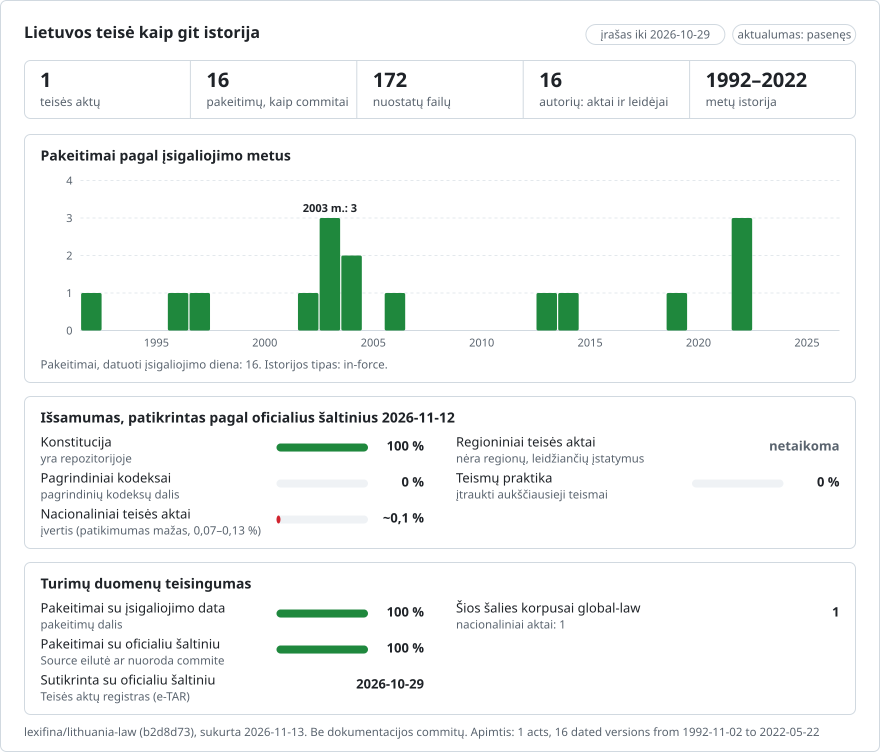

# Lietuva: teisės istorija git sistemoje

**Lietuvių** · [English](README.en.md)

<picture>
<source media="(prefers-color-scheme: dark)" srcset="data/lt/effort-dark.svg">

</picture>

Dalis repozitorijos [lexifina/global-law](https://github.com/lexifina/global-law), kuri yra viena visų šalių teisės git istorija: tai Lietuvos nacionalinė teisė, kurią global-law skaito iš `lithuania/national/acts/`.

Lietuvos Respublikos teisė kaip git istorija: kiekvienai nuostatai skiriamas atskiras failas, kiekvienam pakeitimui – atskiras įrašas (commit) jo įsigaliojimo dieną, o įrašo autorius yra pakeitimą padaręs įstatymas ar teismo dokumentas. `git blame` nurodo aktą, iš kurio kilo pastraipa; `git log` išvardija visus straipsnio pakeitimus; pasirinkus datą gaunamas tą dieną galiojęs tekstas.

Ji laikosi bendros [lexifina/global-law](https://github.com/lexifina/global-law) struktūros, kurioje jai skirta vieta `lt/`. Tekstai pateikiami valstybine lietuvių kalba taip, kaip juos skelbia Teisės aktų registras (e-TAR).

**Kas joje yra dabar**

| Aplankas | Aktas | Redakcijos | Istorija |
| --- | --- | ---: | --- |
| `konstitucija/` | Lietuvos Respublikos Konstitucija (1992 m. spalio 25 d. referendumu priimta Konstitucija) | 12 | Visa: priimtas tekstas (įsigaliojo 1992 m. lapkričio 2 d.) ir visi vėlesni pakeitimai – nuo 1996 m. įstatymo Nr. I-1390 iki įstatymų Nr. XIV-1028, XIV-1029 ir XIV-1030 (įsigaliojo 2022 m. gegužės 22 d.) |

## Teisininko klausimai kaip git komandos

| Klausimas | Komanda |
| --- | --- |
| Ką nustatė 119 straipsnis 2000 m. sausio 1 d.? | `python tools/on.py 2000-01-01 konstitucija art-119` |
| Tas pats, naudojant tik git (bash) | `git show $(git rev-list -1 --before="2000-01-01T23:59:59Z" main -- konstitucija/art-119.md):konstitucija/art-119.md` |
| Tas pats, PowerShell aplinkoje | `$r = git rev-list -1 --before="2000-01-01T23:59:59Z" main -- konstitucija/art-119.md; git show "$($r):konstitucija/art-119.md"` |
| Kas yra kiekvienos 47 straipsnio (žemės nuosavybė) dalies autorius? | `git blame konstitucija/art-047.md` |
| Visi 119 straipsnio (vietos savivalda) pakeitimai, žodis po žodžio | `git log -p --word-diff konstitucija/art-119.md` |
| Visi pakeitimai iš eilės | `git log --reverse --format="%ad %an" --date=short main` |
| Viskas, ką pakeitė įstatymas Nr. XIV-1028 (tiesioginiai merų rinkimai) | `git log --author="XIV-1028" --stat` |
| Visa Konstitucija tam tikrą dieną | `python tools/on.py 2010-01-01 konstitucija` |

Po pakartotinio sukūrimo žymas (tags) atnaujinkite komanda `git fetch --force --tags`: paprastas fetch palieka pasenusias žymas.

## Datos

- Kiekvienas įrašas datuojamas **pakeitimo įsigaliojimo dienos vidurdieniu Europe/Vilnius laiku**. Priėmimo ir paskelbimo datos pateikiamos priedėliuose (trailers); įsigaliojimo diena nurodoma priedėlyje `In-force:`, kurį skaito `tools/on.py`.
- **Kiekvienos redakcijos įsigaliojimo diena yra ta, kurią Teisės aktų registras nurodo savo suvestinei redakcijai** („Suvestinė redakcija nuo …“). Konstitucijos keitimo įstatymas įsigalioja ne anksčiau kaip po vieno mėnesio nuo jo priėmimo (149 str. 3 d.); nė vienas iš šių įstatymų nenustato savo įsigaliojimo dienos.
- **Konstitucija** priimta 1992 m. spalio 25 d. referendumu ir įsigaliojo 1992 m. lapkričio 2 d.
- **2013 m. lapkričio 16 d.** ir **2014 m. sausio 24 d.** nekeičia nė vieno žodžio (žr. toliau); šių dienų įrašuose parašyta „wording unchanged“.
- `--before="YYYY-MM-DD"` be laiko naudoja jūsų laikrodžio paros laiką; naudokite `T23:59:59Z`, kaip parodyta aukščiau, arba įrankį.

## Kaip tikrinama

- **1992 m. ir 2014–2022 m. tekstai yra paties Registro tekstai**: Konstitucija, kokia buvo priimta (e-TAR `rs/legalact`), ir jos suvestinės redakcijos, galiojusios nuo 2014 m. sausio 24 d., 2019 m. rugsėjo 1 d. ir 2022 m. gegužės 22 d. (e-TAR `rs/actualedition`), kiekviena nuskaityta iš fiksuotos Interneto archyvo kopijos.
- **1996–2006 m. redakcijos atkuriamos taikant pakeitimo įstatymus.** Registro suvestinių redakcijų už tuos metus nėra jokiame archyve, todėl kiekviena redakcija gaunama ankstesnei redakcijai pritaikius paties pakeitimo įstatymo žodžius (jo e-TAR tekstą). Kiekviena taisyklė patikrina įstatymo pakeitimo nurodymo žodžius („Pakeisti 119 straipsnio 2 dalį ir ją išdėstyti taip: …“) ir sustabdo kūrimą, jei jie nesutampa.
- **Kiekviena redakcija sutikrinama su paties Seimo skelbiamu** Konstitucijos tekstu (lrs.lt): atkurtas tekstas, galiojęs nuo 2004 m. rugpjūčio 14 d., visais 170 vienetų sutampa su 2006 m. sausį archyvuotu lrs.lt puslapiu, o tekstas, galiojęs nuo 2006 m. gegužės 26 d., sutampa su Registro 2014 m. redakcija ir 2007, 2008, 2014 bei 2016 m. lrs.lt puslapiais. 2019 m. tekstas sutampa su 2020 m. lrs.lt tekstu, o dabartinis tekstas – su lrs.lt tekstu, pateiktu 2026 m. spalio 29 d. ir archyvuotu 2026 m. spalio 20 d. Registro akto puslapyje (archyvuotame 2026 m. spalio 23 d.) galiojančia nurodyta redakcija nuo 2022 m. gegužės 22 d.
- Kiekviena redakcija nuskaitoma iš git jos įsigaliojimo dieną ir dieną prieš ją (`tools/check_repo.py`); abi turi atitikti `corpus.json`. Rezultatai pateikti `REPRODUCE.md`.
- Būklės patikros: `main` šakoje nėra sujungimo (merge) įrašų, įrašų datos niekada neina atgal, niekas nedatuota ateities data, o kiekvieno įrašo priedėliai sėkmingai išanalizuojami komanda `git interpret-trailers --parse`.
- Repozitorija sukuriama antrą kartą iš tų pačių duomenų, ir maišos reikšmės (hashes) turi būti identiškos.

## Ką reiškia „autorius“

Įrašo autorius yra pakeitimą padaręs aktas su el. pašto adresu, kuris negali egzistuoti (`xiv-1028@e-tar.invalid`), kad `git blame` ir `git log --author` jį nurodytų. Įrašo teikėjas (committer) visada yra Lexifina.

- **Pirmasis įrašas** – Konstitucija, kokia ji buvo priimta 1992 m. spalio 25 d. referendumu.
- **Autorystė nustatoma tik pagal šaltinius.** Kiekviena redakcija priskiriama įstatymams, kuriuos Registras nurodo tai redakcijai. Kai tą pačią dieną įsigaliojo keli įstatymai (2003 m. balandžio 21 d., 2004 m. rugpjūčio 14 d., 2022 m. gegužės 22 d.), kiekvienas straipsnis priskiriamas įstatymui, kurį nurodo Registro pastaba po juo („Straipsnio pakeitimas: Nr. …“).
- **125 straipsnio istorija.** 2006 m. įstatymas Nr. X-572 panaikino Lietuvos banko išimtinę teisę leisti pinigus (125 str. 2 d.). 2013 m. lapkričio 16 d. Konstitucinio Teismo pirmininkas paskelbė, kad įstatymo galiojimas sustabdytas, kol Teismas jį nagrinėja, o 2014 m. sausio 24 d. nutarimu KT2-N1/2014 Teismas pripažino, kad įstatymas priimtas pažeidžiant 147 str. 1 d. Nuo tada įstatymas, įskaitant naująją 125 str. 2 d., negali būti taikomas, tačiau ankstesnė formuluotė neatgyja. Registras toliau skelbia 2006 m. žodžius su pastaba, taip daro ir ši istorija: pranešimas ir nutarimas yra įrašai, nekeičiantys nė vieno žodžio.
- Blame autorystę priskiria ištisoms eilutėms (viena dalis ar punktas eilutėje); žodžiams naudokite `git log -p --word-diff`.

## Ko joje nėra

- **Registro suvestinių redakcijų už 1996–2013 m.**: šios redakcijos yra kodu pritaikyti pakeitimo įstatymai, sutikrinti su 2006–2008 m. Seimo puslapiais (žr. aukščiau). Viena korekcija seka suvestiniais tekstais, o ne įstatymu: įstatymas Nr. IX-1378 naujai išdėstyto 84 straipsnio 11 punktą baigia tašku, o visuose suvestiniuose tekstuose paliktas sąrašo kabliataškis.
- **Trijų 1991–1992 m. sudedamųjų dalių**, kurias išvardija 150 straipsnis (Konstitucinio įstatymo „Dėl Lietuvos valstybės“, Konstitucinio akto dėl nesijungimo į postsovietines Rytų sąjungas ir Konstitucijos įsigaliojimo tvarkos įstatymo). Tai atskiri aktai. Ketvirtoji sudedamoji dalis, 2004 m. Konstitucinis aktas dėl narystės Europos Sąjungoje, yra įtraukta (`konstitucija/sudedamoji-4-es.md`) tiesiai iš paties įstatymo Nr. IX-2343.
- **Paprastųjų įstatymų ir kodeksų.** Civilinis kodeksas, Baudžiamasis kodeksas ir Asmens duomenų teisinės apsaugos įstatymas dar nesukurti: Registras blokuoja automatizuotą skaitymą, jo atvirųjų duomenų API (data.gov.lt) šiam kūrimui neprieinama, o archyvuose yra tik dalis daugybės šių aktų redakcijų.
- **Atmestų pataisų.** Pasiūlymai, kurie Seime ar referendume nebuvo priimti, nepakeitė nė vieno žodžio ir nėra įrašyti.

## Kaip sukurta

Lexifina skaito čia išvardytus šaltinius ir viename korpuso faile įrašo kiekvieno akto datuotas redakcijas bei kiekvieną pakeitimą padariusius įstatymus. `tools/build.py` iš to failo sukuria šią repozitoriją, o tas pats korpusas visada duoda tas pačias įrašų maišos reikšmes; išsami informacija ir patikros pateiktos `REPRODUCE.md`. Lexifina kodą parašė modelis (Claude); jis neparašė jokio teisinio teksto, o kuriant istoriją nepaleidžiamas joks modelis.

Optinis simbolių atpažinimas (OCR) nenaudotas, ir joks DI modelis nerašė ir nekeitė teisinio teksto. Scenarijus parašė ir šaltinius parinko Claude Opus 5.5; žr. `REPRODUCE.md`.

## Šaltiniai

| Šaltinis | Rūšis | Ankstesnės redakcijos pagal datą | Nurodo keičiantįjį aktą | API ar masinis atsisiuntimas | Pastabos |
| --- | --- | --- | --- | --- | --- |
| [Teisės aktų registras (e-TAR)](https://www.e-tar.lt) per [Interneto archyvą](https://web.archive.org/) | Oficialus skelbimas | taip (suvestinės redakcijos su datomis) | taip, kiekvienam straipsniui | – | – |
| [Registro atvirieji duomenys (data.gov.lt, duomenų rinkinys 2613)](https://data.gov.lt/datasets/2613/) | Oficialūs atvirieji duomenys (aktai, tekstai, suvestinės redakcijos) | taip | iš dalies | taip (Spinta API) | – |
| [Seimas: Konstitucija (lrs.lt)](https://www.lrs.lt/home/Konstitucija/Konstitucija.htm) | Parlamento skelbiamas suvestinis tekstas | tik dabartinė (archyvuota 2006–2026 m.) | taip, kiekvienam straipsniui | ne | – |
| [e-seimas.lrs.lt](https://e-seimas.lrs.lt) | Seimo teisės aktų duomenų bazė | taip | taip | ne | – |
| [lt-teises-aktai](https://github.com/Yiin/lt-teises-aktai) | Savanorių git istorija iš e-TAR | taip | iš dalies | netaikoma | Tik kaip ankstesnis darbas; nieko nenukopijuota |
| [legalize-lt](https://github.com/legalize-dev/legalize-lt) | Atkurta istorija iš e-TAR (duomenys CC BY 4.0) | taip | iš dalies | git | Patikrinta, nenaudota: ties įrašu 76c1b579 jos asmens duomenų įstatymo tekstas (2025-01-01) nėra e-TAR redakcija (palikti panaikinti straipsniai, trūksta 7¹, 14¹, 19¹, 32¹ straipsnių, prarasti viršutiniai indeksai) |

Paieškos vadovai: [GlobaLex](https://www.nyulawglobal.org/globalex/) ir [Law Library of Congress Guide to Law Online](https://www.loc.gov/research-centers/law-library-of-congress/researcher-resources/guide-to-law-online/).

## Licencija

Teisės aktai Lietuvoje nėra autorių teisių objektai (Autorių teisių ir gretutinių teisių įstatymo 5 straipsnis). Tekstai paimti iš Teisės aktų registro (www.e-tar.lt, skaityta per Interneto archyvą) ir sutikrinti su Seimo skelbiamu tekstu (www.lrs.lt). Lexifina savo indėlį pagal CC0 1.0 perduoda visuomenės nuosavybėn (public domain); žr. `LICENSE`.

Ši repozitorija nėra teisinė konsultacija ir nėra oficialus leidinys.

Tai angliškos versijos ([README.en.md](README.en.md)) vertimas; jei jos skiriasi, galioja angliška versija.

## Daugiau

Iš repozitorijos [lexifina/global-law](https://github.com/lexifina/global-law) (anglų kalba):

- [FEATURES.md](https://github.com/lexifina/global-law/blob/main/FEATURES.md): visos funkcijos ir ką turi palaikyti kiekvienas korpusas (`git blame`, `law.py`, MCP įrankiai)
- [FAQ.md](https://github.com/lexifina/global-law/blob/main/FAQ.md): klausimai ir atsakymai · [CONTRIBUTING.md](https://github.com/lexifina/global-law/blob/main/CONTRIBUTING.md): kaip pasiūlyti pakeitimų · [MCP.md](https://github.com/lexifina/global-law/blob/main/MCP.md): MCP serveris · [REPRODUCE.md](https://github.com/lexifina/global-law/blob/main/REPRODUCE.md): kaip tai sukurta · [CHANGELOG.md](https://github.com/lexifina/global-law/blob/main/CHANGELOG.md)
- [FRESHNESS.md](https://github.com/lexifina/global-law/blob/main/FRESHNESS.md): koks aktualus kiekvienas korpusas · [Stebėsena](https://github.com/lexifina/global-law/tree/main/monitoring): ar veikia atnaujinimai · [WATCHING.md](https://github.com/lexifina/global-law/blob/main/WATCHING.md): kaip kiekvienas oficialus šaltinis stebimas dėl pakeitimų
- [performance/](https://github.com/lexifina/global-law/tree/main/performance): kaip greitai veikia įrankiai, išmatuota
- [visualisations/](https://github.com/lexifina/global-law/tree/main/visualisations): diagramos ir ryšiai viso pasaulio teisėje
- [Pažeidžiamumai](https://github.com/lexifina/global-law/tree/main/vulnerabilities): klaidos teisės aktuose tokiuose, kokie jie paskelbti
