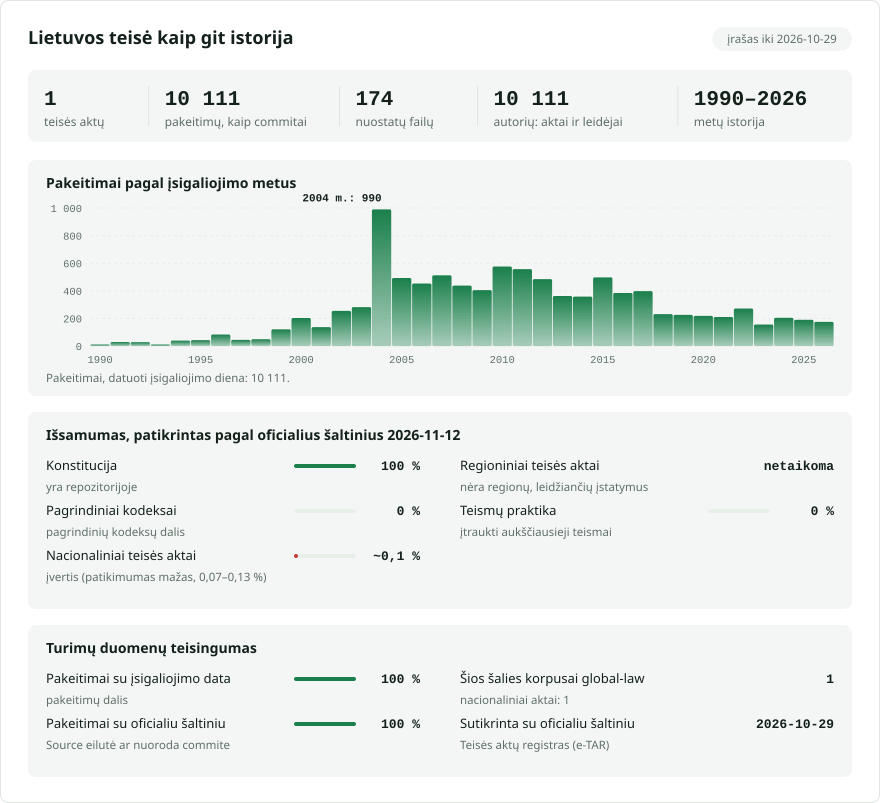

# Lietuva: teisės istorija git sistemoje

**Lietuvių** · **[Or read it in English](README.en.md)**

<picture>
<source media="(prefers-color-scheme: dark)" srcset="data/lt/effort-dark.svg">

</picture>

Lietuvos teisė kaip git istorija: kiekvienai nuostatai skiriamas atskiras failas, kiekvienam pakeitimui – atskiras įrašas (commit) jo įsigaliojimo dieną, o įrašo autorius yra pakeitimą padaręs aktas. `git blame` nurodo aktą, iš kurio kilo kiekviena pastraipa; `git log` išvardija visus straipsnio pakeitimus; pasirinkus datą gaunamas tą dieną galiojęs tekstas.

Dalis repozitorijos [lexifina/global-law](https://github.com/lexifina/global-law), kuri yra viena visų šalių teisės git istorija: tai Lietuvos nacionalinė teisė, kurią global-law skaito iš `lithuania/national/acts/`.

**Kas joje yra dabar:** 1992 m. spalio 25 d. referendumu priimta Konstitucija ir visi vėlesni jos pakeitimai: 12 redakcijų – nuo teksto, įsigaliojusio 1992 m. lapkričio 2 d., iki redakcijos, galiojančios nuo 2022 m. gegužės 22 d., – kurias padarė 13 pakeitimo įstatymų, bei 2 Konstitucinio Teismo dokumentai, nekeičiantys nė vieno žodžio (iš viso 16 įrašų). Kitų aktų čia dar nėra. [`konstitucija/README.md`](konstitucija/README.md) išvardija visas nuostatas ir kiek kartų kiekviena buvo pakeista.

Kiekviena nuostata yra atskiras failas aplanke `konstitucija/`: preambulė (`preambule.md`), 15 skirsnių pavadinimų (nuo `skirsnis-01.md` iki `skirsnis-15.md`), 154 straipsniai (nuo `art-001.md` iki `art-154.md`; `art-119.md` yra 119 straipsnis, vietos savivalda) ir nuo 2004 m. Konstitucinis aktas „Dėl Lietuvos Respublikos narystės Europos Sąjungoje“ (`sudedamoji-4-es.md`).

Tekstas pateikiamas lietuvių kalba taip, kaip jį skelbia Teisės aktų registras (e-TAR). Vertimas į anglų kalbą nėra šio įrašo dalis.

## Klausimai kaip git komandos

| Klausimas | Komanda |
| --- | --- |
| Visi Konstitucijos 119 straipsnio pakeitimai | `git log -p --word-diff -- konstitucija/art-119.md` |
| Kuris aktas parašė kiekvieną 119 straipsnio eilutę? | `git blame konstitucija/art-119.md` |
| Visi Konstitucijos pakeitimai su kiekvieno įsigaliojimo diena | `git log --grep="^In-force:" --format="%h %(trailers:key=In-force,valueonly,separator=) %an"` |
| 119 straipsnis, galiojęs 2000 m. sausio 1 d. | `python tools/on.py 2000-01-01 konstitucija art-119` |

**Už git ribų** šį įrašą taip pat viešai ir nemokamai teikiame:

- **[Klauskite Claude apie Lietuvos teisę](https://global-law.lexifina.com/v1/try_claude?country=lithuania)**: atidaro Claude su paruoštu pirmuoju klausimu.
- **[Klauskite ChatGPT](https://global-law.lexifina.com/v1/try_chatgpt?country=lithuania)**: tas pats klausimas ChatGPT.
- **[Iškvieskite API naršyklėje](https://global-law.lexifina.com/v1/search_law?query=atostogas&jurisdictions=lithuania)**: žodžio „atostogas“ paieška Lietuvos teisėje, atsakymas JSON formatu. Dokumentacija pateikta [čia](https://lexifina.com/api/global-law).

Abu asistentai įrašą skaito per nemokamą Global law jungtį (MCP, `https://global-law.lexifina.com/mcp`); pirmą kartą pokalbis pateikia nuorodą, kuria jungtis pridedama. Klauskite lietuviškai arba angliškai.

**Lengvai paleiskite patys.** Užtenka git ir Python, o įrankiai veikia jūsų kompiuteryje:

```sh
git clone --depth 1 https://github.com/lexifina/global-law && cd global-law
python3 tools/countries.py add lithuania/national/acts
python3 tools/law.py show 2026-01-01 lithuania/national/acts/konstitucija/art-119.md
```

Atidarytas Claude Code, Cursor, VS Code ar Codex aplinkoje, klonas paleidžia ir vietinį MCP serverį su tais pačiais įrankiais ([MCP.md](https://github.com/lexifina/global-law/blob/main/MCP.md)).

## Datos

Kiekvienas įrašas datuojamas pakeitimo įsigaliojimo dienos vidurdieniu Europe/Vilnius laiku, o ta diena nurodoma jo priedėlyje (trailer) `In-force:`:

- kiekvienai redakcijai – diena, kurią Registras nurodo savo suvestinei redakcijai („Suvestinė redakcija nuo …“). Konstitucijos keitimo įstatymas įsigalioja ne anksčiau kaip po vieno mėnesio nuo jo priėmimo (149 str. 3 d.); nė vienas iš šių įstatymų nenustato savo įsigaliojimo dienos;
- Konstitucijai, kokia ji buvo priimta, – 1992 m. lapkričio 2 d.;
- 2013 m. lapkričio 16 d. ir 2014 m. sausio 24 d. – tai Konstitucinio Teismo pranešimas, kuriuo sustabdytas įstatymo Nr. X-572 (125 straipsnis, 2006 m.) galiojimas, ir jo nutarimas KT2-N1/2014, kuriuo pripažinta, kad įstatymas priimtas pažeidžiant 147 str. 1 d. Registras toliau skelbia 2006 m. žodžius su pastaba, taip daro ir šis įrašas: abiejuose įrašuose parašyta „wording unchanged“.

Kiekvienas pakeitimas priskiriamas aktui, kurį Registras nurodo tai redakcijai (`Įstatymas Nr. XIV-1028`); kai tą pačią dieną įsigaliojo keli įstatymai (2003 m. balandžio 21 d., 2004 m. rugpjūčio 14 d., 2022 m. gegužės 22 d.), kiekvienas straipsnis priskiriamas įstatymui, kurį nurodo Registro pastaba po juo („Straipsnio pakeitimas: Nr. …“). Pirmasis įrašas priskiriamas 1992 m. spalio 25 d. referendumui.

## Kaip tikrinama

- Konstitucija, kokia ji buvo priimta, ir redakcijos, galiojančios nuo 2014 m., yra paties Registro tekstai, kiekvienas nuskaitytas iš fiksuotos Interneto archyvo kopijos. Registro 1996–2013 m. redakcijų nėra jokiame archyve, todėl šios redakcijos gaunamos ankstesnei redakcijai pritaikius paties pakeitimo įstatymo žodžius; kūrimas sustoja, jei įstatymo pakeitimo nurodymo žodžiai nesutampa.
- Tekstai, galiojantys nuo 2004 m., visais 170 vienetų sutampa su paties Seimo skelbiamu Konstitucijos tekstu (lrs.lt), archyvuotu 2006–2026 m. ir pateiktu 2026 m. spalio 29 d.; atkurtas 2006 m. tekstas taip pat sutampa su Registro 2014 m. redakcija.
- Kiekviena redakcija nuskaitoma iš git jos įsigaliojimo dieną ir dieną prieš ją (`tools/check_repo.py`) ir turi atitikti korpusą. Rezultatai pateikti [`REPRODUCE.md`](REPRODUCE.md).
- Istorija tik papildoma: nėra sujungimo (merge) įrašų, įrašų datos neina atgal, nėra įrašų, datuotų ateities data, o kiekvieno įrašo priedėliai sėkmingai išanalizuojami.

## Ko joje nėra

- **Paprastųjų įstatymų ir kodeksų.** Sukurta tik Konstitucija; kodeksų, kitų įstatymų ir likusios Registro dalies čia dar nėra.
- **Teismų praktikos, vietos aktų, tarptautinių sutarčių, ES teisės ir įstatymų projektų.** Jų čia nėra, išskyrus 2013 m. Konstitucinio Teismo pranešimą ir 2014 m. nutarimą dėl 125 straipsnio.
- **Paties Registro 1996–2013 m. redakcijų.** Šios redakcijos yra kodu pritaikyti pakeitimo įstatymai, patikrinti, kaip aprašyta aukščiau. Vienoje vietoje laikomasi suvestinių tekstų, o ne įstatymo: įstatymas Nr. IX-1378 naujai išdėstyto 84 straipsnio 11 punktą baigia tašku, o visuose suvestiniuose tekstuose paliktas sąrašo kabliataškis.
- **Trijų 1991–1992 m. Konstitucijos sudedamųjų dalių**, kurias išvardija 150 straipsnis (Konstitucinio įstatymo „Dėl Lietuvos valstybės“, Konstitucinio akto dėl nesijungimo į postsovietines Rytų sąjungas ir Konstitucijos įsigaliojimo tvarkos įstatymo): tai atskiri aktai. Ketvirtoji, dėl narystės Europos Sąjungoje, čia yra.

## Šaltiniai

| Šaltinis | Rūšis | Ankstesnės redakcijos | Pastabos |
| --- | --- | --- | --- |
| [Teisės aktų registras (e-TAR)](https://www.e-tar.lt), skaitytas per [Interneto archyvą](https://web.archive.org/) | Oficialus teisės aktų registras | taip, suvestinės redakcijos su datomis (fiksuotos kopijos) | Konstitucija, kokia ji buvo priimta, visi pakeitimo įstatymai ir Teismo dokumentai bei redakcijos, galiojančios nuo 2014 m. |
| [Seimas: Konstitucija (lrs.lt)](https://www.lrs.lt/home/Konstitucija/Konstitucija.htm) | Parlamento skelbiamas suvestinis tekstas | tik dabartinė (archyvuota 2006–2026 m.) | Su juo sutikrinta kiekviena redakcija nuo 2004 m. |

## Licencija

Žr. [`LICENSE`](LICENSE). Teisės aktai Lietuvoje nėra autorių teisių objektai (Autorių teisių ir gretutinių teisių įstatymo 5 straipsnis); savo indėlį (istorijos sutvarkymą, įrašų pranešimus, lenteles ir įrankius) Lexifina pagal CC0 1.0 perduoda visuomenės nuosavybėn.

Joks DI modelis nerašė, nevertė ir netaisė teisinio teksto; scenarijus parašė DI modelis, kuris taip pat parašė angliškas 2013 m. pranešimo ir 2014 m. nutarimo santraukas įrašų pranešimuose (žr. [`REPRODUCE.md`](REPRODUCE.md)).

Tai angliškos versijos ([README.en.md](README.en.md)) vertimas; jei jos skiriasi, galioja angliška versija.

## Daugiau

Iš repozitorijos [lexifina/global-law](https://github.com/lexifina/global-law) (anglų kalba):

- [FEATURES.md](https://github.com/lexifina/global-law/blob/main/FEATURES.md): visos funkcijos ir ką turi palaikyti kiekvienas korpusas (`git blame`, `law.py`, MCP įrankiai)
- [FAQ.md](https://github.com/lexifina/global-law/blob/main/FAQ.md): klausimai ir atsakymai · [CONTRIBUTING.md](https://github.com/lexifina/global-law/blob/main/CONTRIBUTING.md): kaip pasiūlyti pakeitimų · [MCP.md](https://github.com/lexifina/global-law/blob/main/MCP.md): MCP serveris · [REPRODUCE.md](https://github.com/lexifina/global-law/blob/main/REPRODUCE.md): kaip tai sukurta · [CHANGELOG.md](https://github.com/lexifina/global-law/blob/main/CHANGELOG.md)
- [FRESHNESS.md](https://github.com/lexifina/global-law/blob/main/FRESHNESS.md): koks aktualus kiekvienas korpusas · [Stebėsena](https://github.com/lexifina/global-law/tree/main/monitoring): ar veikia atnaujinimai · [WATCHING.md](https://github.com/lexifina/global-law/blob/main/WATCHING.md): kaip kiekvienas oficialus šaltinis stebimas dėl pakeitimų
- [performance/](https://github.com/lexifina/global-law/tree/main/performance): kaip greitai veikia įrankiai, išmatuota
- [visualisations/](https://github.com/lexifina/global-law/tree/main/visualisations): diagramos ir ryšiai viso pasaulio teisėje
- [Pažeidžiamumai](https://github.com/lexifina/global-law/tree/main/vulnerabilities): klaidos teisės aktuose tokiuose, kokie jie paskelbti
